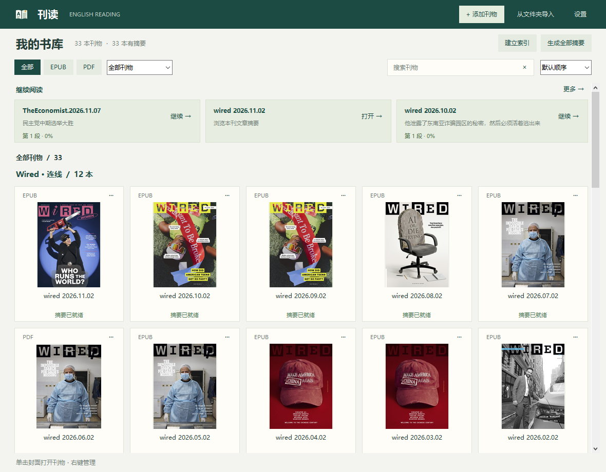
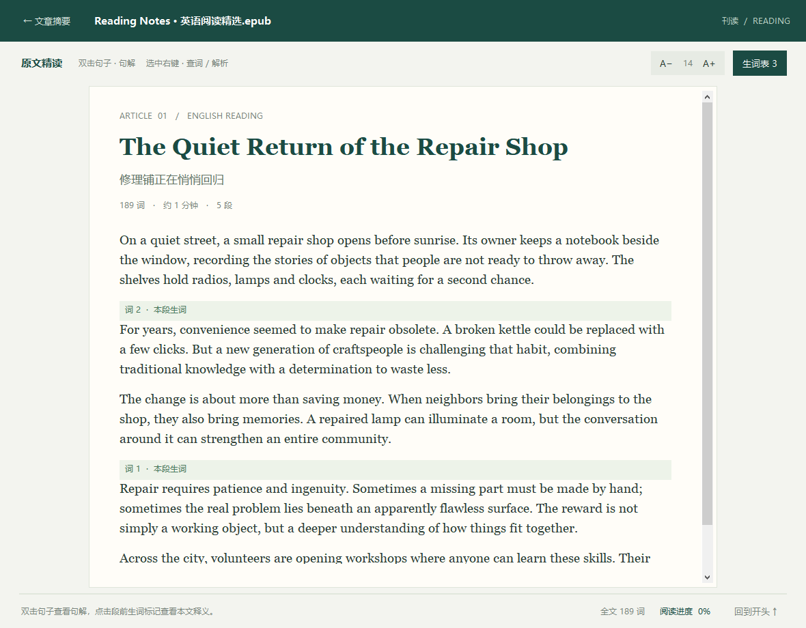
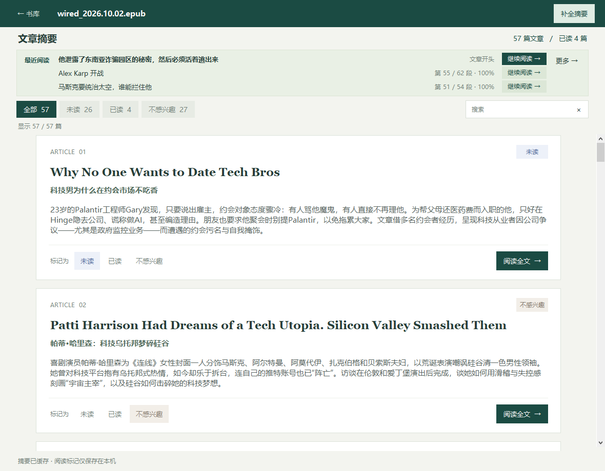
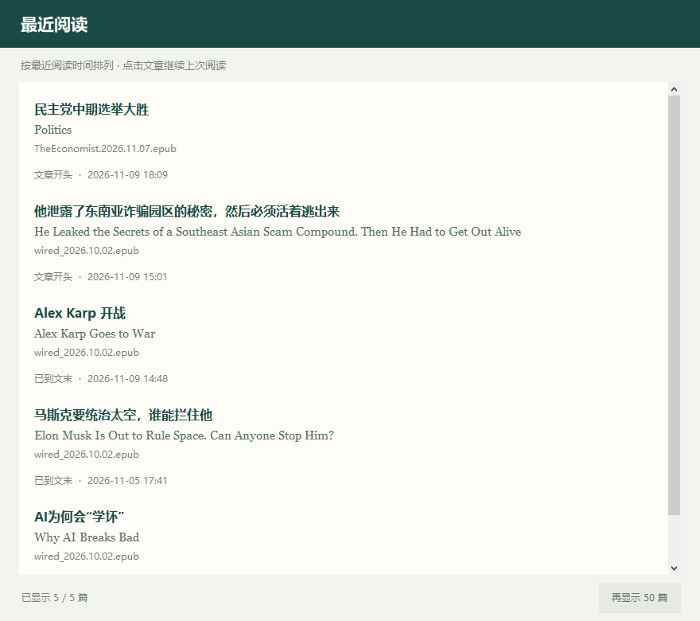
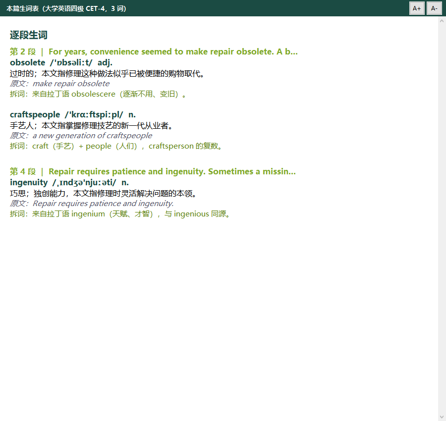
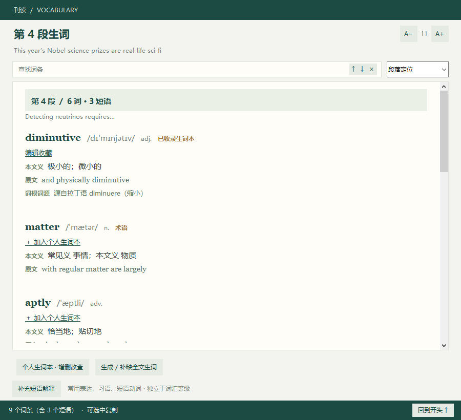
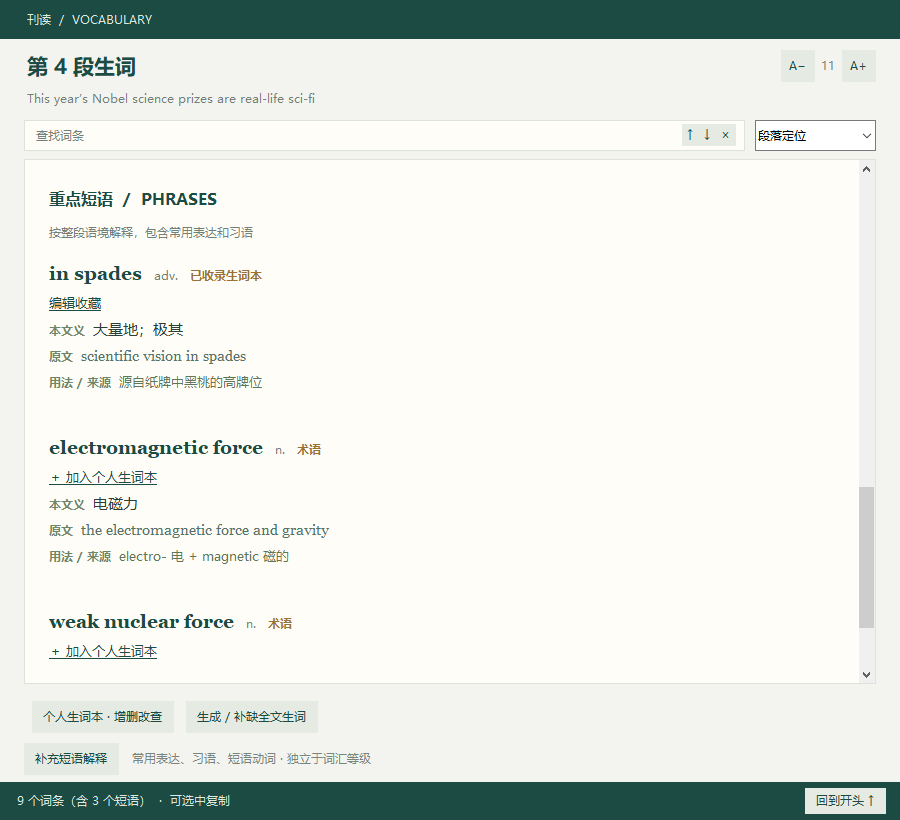
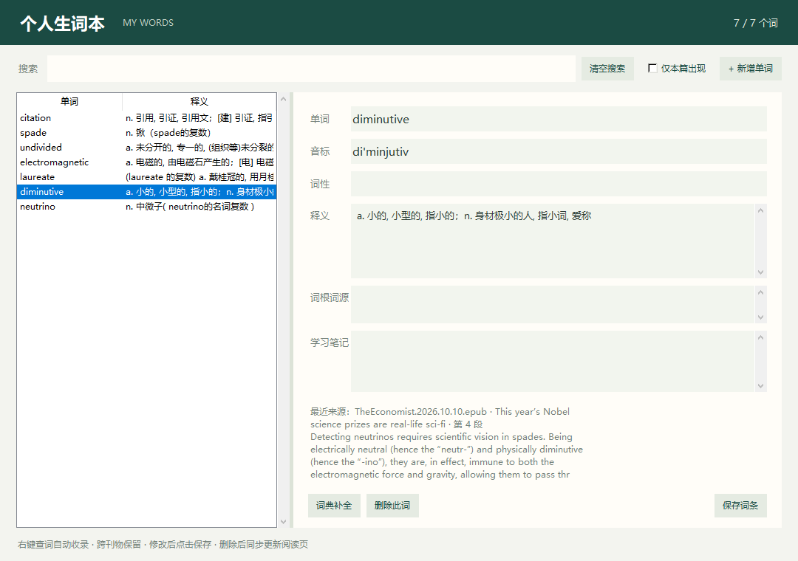
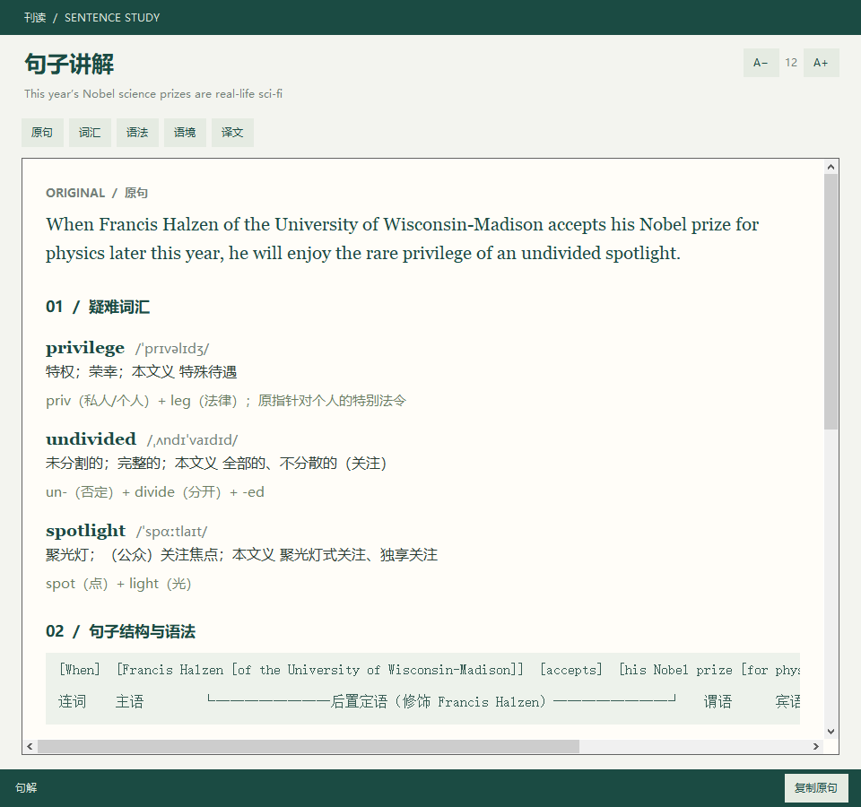

# 刊读 · Kandu Desktop

「刊读」Android App 的 Windows 桌面版：选择期刊目录，基于大模型辅助精读
经济学人 / Wired 等英文原刊（EPUB / PDF）。

版本历史与每版变更见 [变更记录](CHANGELOG.md)（当前 v0.8.18）。

## 界面预览

用中文摘要快速找到感兴趣的文章，在舒展的英文排版中精读；阅读位置自动保存，下次从最近阅读入口继续。

每张截图单独展示，点击图片可查看原图。

**我的书库：按刊名分区、同刊新期优先、最近阅读直达文章，分类、搜索与 EPUB / PDF 筛选可组合使用。**

[](docs/screenshots/desktop-library.png)

**原文阅读：中英文标题、全文词数、阅读进度与段落生词入口。**

[](docs/screenshots/desktop-reader.png)

**文章摘要与最近阅读：继续阅读入口、文章标记与搜索筛选。**

[](docs/screenshots/desktop-digest.png)

**更多最近阅读：首页跨刊物汇总，摘要页查看本刊记录，点击文章回到上次阅读位置。**

[](docs/screenshots/desktop-recent.png)

**全篇生词表：暖白纸面、分层词条、查找与段落定位。**

[](docs/screenshots/desktop-vocabulary.png)

**段落生词：阅读《经济学人》诺奖科学报道时，直接查看该段的音标、本文义与词源。**

[](docs/screenshots/desktop-paragraph-vocabulary.png)

**重点短语：常用表达和习语按本文语境解释，每个单词与短语都可以一键加入个人生词本。**

[](docs/screenshots/desktop-phrases.png)

**个人生词本：右键查词自动收藏，跨刊物保留；可搜索、编辑释义与笔记、删除词条。**

[](docs/screenshots/desktop-wordbook.png)

**句子讲解：原句、疑难词汇、语法成分与原文对应、上下文与参考译文，可通过顶部导航快速定位。**

[](docs/screenshots/desktop-analysis.png)

以上桌面截图来自当前版本实际运行的程序，使用现有书库中的真实刊物封面和文章：书库与摘要展示 Wired 等刊物，原文、生词与句解展示《经济学人》2026 年 10 月 10 日期的 “This year’s Nobel science prizes are real-life sci-fi”。摘要、释义与讲解均使用已有的实际生成结果。下载包的版本以下载区标注为准。

### 其他版本

三个版本分别维护，按阅读场景选择；目前不提供跨端自动同步。

**[Android 手机版](https://github.com/haithink/magread)**：手机上阅读 EPUB / PDF，随时查看生词与句解。

[](https://raw.githubusercontent.com/haithink/magread/main/docs/screenshots/android-reader.png)

**[Chrome 网页版](https://github.com/haithink/magread-chrome)**：保留网页原文，在侧栏查看摘要、生词和句解。

[](https://raw.githubusercontent.com/haithink/magread-chrome/main/docs/screenshots/chrome-vocabulary.png)

## 下载 Windows 安装包

**[下载刊读 v0.8.18（Windows 64 位，约 62 MiB）](https://github.com/haithink/magread-desktop/raw/refs/heads/main/downloads/Kandu-v0.8.18-win64.zip)**

免安装：解压后运行 `Kandu.exe`（`_internal` 依赖目录需与 exe 同级保留）。
数据目录在 `%LOCALAPPDATA%\KanduDesktop`，与解压位置无关。

## 功能

1. **书库** — 添加刊物（多选）/ 从文件夹导入，文件纳入应用自管的存储与索引，
   增删自如，不再依赖磁盘上的某个目录；支持后台建立内容索引（秒开）与进度查询
2. **摘要** — 打开刊物分批调用大模型，生成每篇文章中英文标题 + 中文摘要，缓存到本地；
   支持「批量生成全部摘要」后台任务（跳过已完成、失败可续）；
   可逐篇标记未读 / 已读 / 不感兴趣，按状态筛选、搜索中英文标题与摘要
3. **阅读** — 居中纸面与英文衬线排版，中英文标题、字数与预计阅读时间，阅读进度与回到开头；
   双击句子 → 句解（疑难词汇 / 语法成分对应 / 语境 / 参考译文）；选中后右键解析；
   段前「词 N」查看本段生词与重点短语，工具栏「生词表」看全篇；词条可一键收藏，正文与弹层字号可调；
   「与 AI 讨论」围绕文章连续提问，支持选中引用、流式回答与自动保存会话；
   Ctrl+F 查找标题与正文，支持高亮、结果计数和前后定位
4. **LLM 配置** — 多配置管理（新增/编辑/删除/★ 默认），OpenAI 兼容 / Anthropic 原生；
   支持粘贴 cc-switch JSON 自动识别；连通性测试；获取可用模型；
   生词表失败块**自动轮换其他已配置 LLM** 补缺
5. **可靠性** — SSE 流式、推理模型额度自适应重试、截断 JSON 自动修补、分批落盘、
   生词表词条级段落锚点自愈、运行日志（error.log）

数据目录：`%LOCALAPPDATA%\KanduDesktop`（settings.json / books.json / vocab / covers / cache / article_states）。
个人生词本保存在该目录的 `wordbook.sqlite3`，跨刊物共享，移除刊物或清理文章缓存不会删除收藏。

v0.8.18 修复未生成词表时把少量个人收藏误当作全文生词表的入口行为。点击「生成生词表」直接生成全文；
段落入口区分「待生成」、个人收藏数与已生成词条数，词表窗口说明尚未生成或缺段状态，查看收藏不会额外请求模型。

v0.8.17 增加阅读页文本搜索：按 Ctrl+F 或点击「查找 Ctrl+F」，输入词语后高亮标题与正文中的匹配项，显示当前位置和总数。
Enter / F3 查找下一个，Shift+Enter / Shift+F3 查找上一个，Esc 关闭；选中文字后打开可直接搜索选中内容。
查找忽略大小写，支持中文和标点，全部本地执行，无需请求模型。生词徽标刷新后保留匹配和阅读位置。

文章 AI 讨论：阅读页点击「与 AI 讨论」，或选中文字后右键「向 AI 提问」，Ctrl+Enter 发送。
每篇文章独立保存会话，关闭后可继续追问；记录位于 `%LOCALAPPDATA%\KanduDesktop\discussions`，清理生成缓存不会删除会话。

### 生词表生成

- 首次打开文章只自动匹配个人生词本，少量收藏不代表全文词表已经生成。点击顶部「生成生词表」开始生成；
  每段「待生成」入口可查看已有收藏，再点击窗口中的「生成 / 补缺全文生词」。生成完成后显示各段词条数。
- 默认词汇水平为 CET-4。用本地词表排除已掌握词，用 ECDICT 还原词形、批量补充音标；
  LLM 负责本文义项、词根词源、术语与熟词僻义判断。
- 标题与首个正文块合并；每次只发送本块候选词，保留正文语境，最多两块同时生成。
- 模型返回紧凑词条，段首与原文短语由本地提取；音标已收录的词无需模型重复生成。
- 逐块保存并兼容旧缓存；已处理段落不重新请求，失败块仍可换模型补缺。
- 模型偶尔把词条放错段时，按原文唯一匹配自动归位；部分段落失败只补这些段落，
  保留同次响应中已成功的段落。再次点击补缺可重试曾失败的同名渠道。
- DeepSeek 的生词任务显式关闭思考模式，避免长时间等待后只有推理、没有词条；
  摘要和句解保持各自的请求设置。
- 校验严格保留未完成状态；流式中断、缺段或格式错误会记录具体原因到缓存 `chunkErrors`，
  失败原因也显示在状态栏并写入 `error.log`，便于区分接口、输出格式与安全过滤问题。
- 生成时显示已完成块数和实时接收字数，完成后显示用时；缓存中的 `generationStats`
  记录调用次数、输入/输出字符数与用时（字符数不等于模型 token 数）。

速度受模型和网关影响。首次使用离线词典需要建索引，进入阅读页时会后台预热。

## 开发运行

```bash
python -m venv .venv
.venv\Scripts\python.exe -m pip install -r requirements.txt -i https://pypi.tuna.tsinghua.edu.cn/simple
.venv\Scripts\python.exe main.py
```

注意：pymupdf 钉在 1.24.14（2.0 的 wheel 在部分机器上段错误）。

## 打包 exe

```bat
build_exe.bat
```

产物：`dist\Kandu\Kandu.exe`（整目录拷走即可用），并同步生成
`dist\Kandu-v<版本>-win64.zip` 分发包。
tcl/tk、sqlite3 等 DLL 从 anaconda（`D:\anaconda\Library`）手动打入，见脚本参数；
如 Python 安装位置不同，改脚本里的路径。构建脚本自带自检：exe 未更新或被
运行中进程锁定时会明确报错。

## 与 Android 版的关系

缓存/设置 JSON 字段与 Android 版同构（digest.json / vocab_*_level.json /
analysis_<sha1>.json），提示词、生成流程、修复策略保持一致，便于双端对照排错。
另有 Chrome 扩展版（`../magread-chrome`，网页文章精读辅助），见其 README。

## 许可证

Copyright (c) 2026 haithink and contributors.

本项目原创代码采用 [GNU Affero General Public License v3.0](LICENSE)
（SPDX：`AGPL-3.0-only`）。桌面版使用的 PyMuPDF 提供 AGPL 与商业许可，
本项目采用与其开源许可兼容的 AGPL 授权方式。

分发打包应用时，应按适用许可随附许可证并提供对应版本的完整源码和构建材料。
词典、词表和其他依赖保留各自的许可，详见 [第三方资源说明](THIRD_PARTY_NOTICES.md)。
